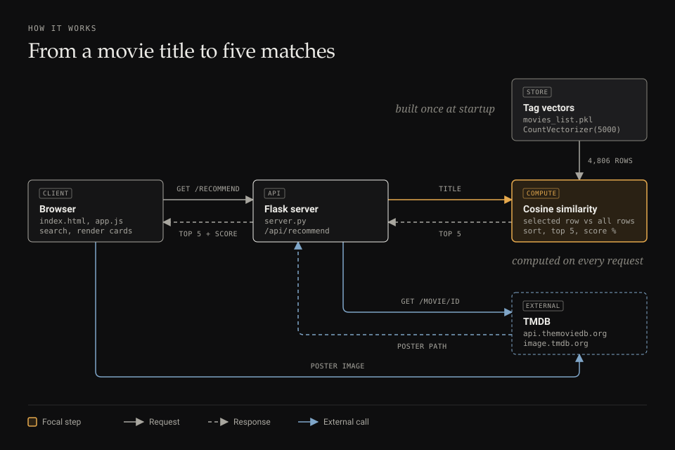

# CineMatch AI

Pick a movie, get the five most similar ones. Similarity is calculated from each film's plot overview, genres, keywords, cast and director.

**Live site: https://cinematch-4wlb.onrender.com/**

---

## How it works



1. **Startup.** `server.py` loads `movies_list.pkl` (4,806 movies, each with a `tags` text field) and fits a `CountVectorizer` with a 5,000-term vocabulary and English stop words removed.
2. **Request.** When you press **Find similar movies**, the browser sends the selected title to `/api/recommend`.
3. **Similarity.** The server compares that movie's vector with every other movie using cosine similarity, sorts the scores and keeps the top five after the movie itself. The match percentage is `min(int(score * 100), 99)`.
4. **Posters.** Poster paths are looked up from TMDB through `/api/poster/<id>`, so the TMDB key never reaches the browser. The images themselves load straight from `image.tmdb.org`.

Nothing is precomputed. Every recommendation is calculated when you ask for it.

## Run it locally

```bash
pip install -r requirements.txt
python server.py
```

Then open http://127.0.0.1:5000. Python 3.11 or newer is needed.

To use your own TMDB key, set it before starting the server:

```bash
export TMDB_API_KEY=your_key_here      # Windows PowerShell: $env:TMDB_API_KEY="your_key_here"
```

## API

| Endpoint | Returns |
| --- | --- |
| `GET /api/movies` | Every title, in dataset order |
| `GET /api/recommend?title=Avatar` | The selected movie and its five closest matches with scores |
| `GET /api/poster/<movie_id>` | The TMDB poster URL, or `null` |
| `GET /api/sample?n=16` | Random movies from the catalog, used for the poster wall on the home screen |

## Project structure

```
Movie-Recommendation-ML-Model/
├── Frontend/
│   ├── index.html          page markup
│   ├── style.css           styles
│   ├── app.js              search box, API calls, rendering
│   ├── server.py           Flask backend and recommendation code
│   ├── requirements.txt    Python dependencies
│   ├── movies_list.pkl     preprocessed movie data (movie_id, title, tags)
│   ├── favicon.svg         site icon
│   ├── how-it-works.svg    diagram used in this README
│   └── app.py              the original Streamlit version
├── Notebook/
│   ├── Movie_Recomendation.ipynb   data preparation and model prototype
│   └── tmdb_5000_movies.csv        source dataset
└── README.md
```
## Author
**Soumen Sen**
